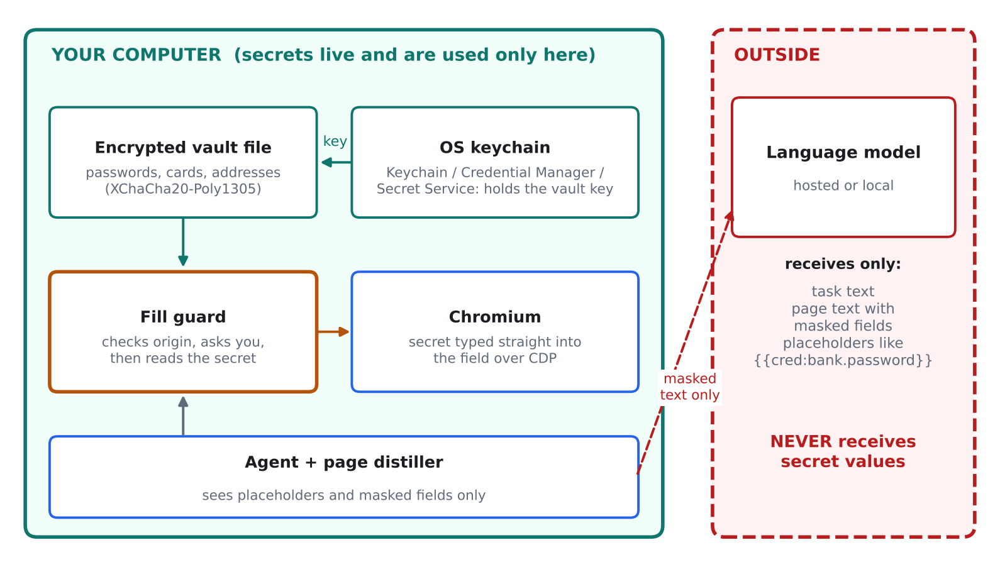
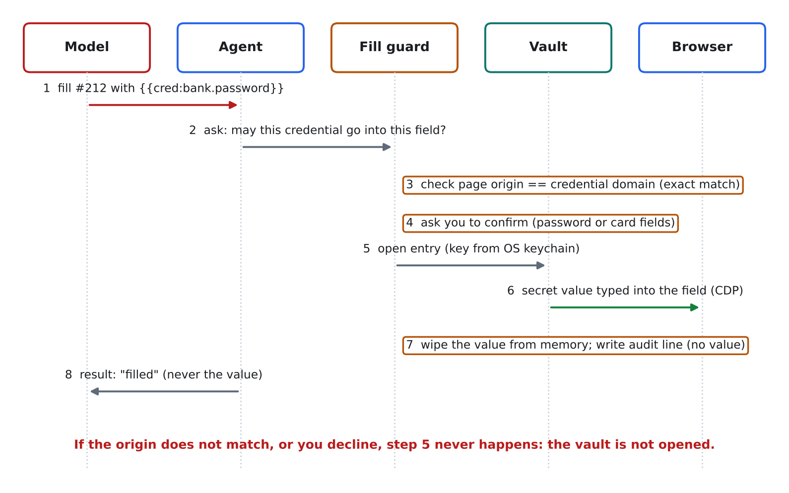
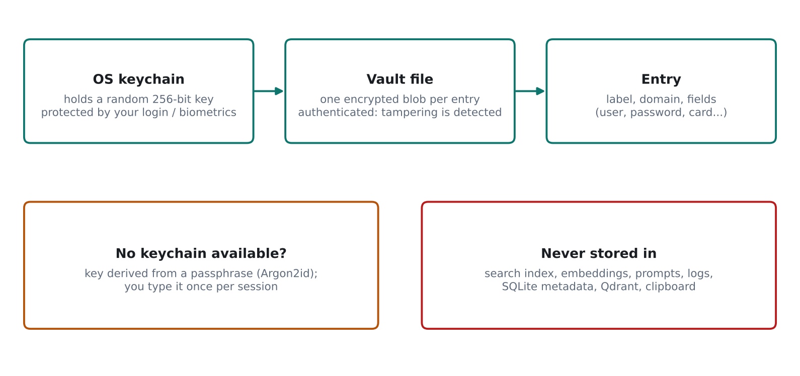

# Keeping personal details local: the form-filling vault

> **Status: design. Not built yet.** Nothing on this page is implemented in the code today. The agent already masks card
> numbers in its audit log and keeps settings secrets out of the model, but there is no credential store. This document is the
> plan, with the tests that will have to pass before any claim below is made true.

**Goal:** the agent can fill your passwords, cards and addresses into web forms, and **no secret value ever reaches a language
model, a log, the search index or the network.**

## 1. The picture: what stays on your computer

The model decides *what to do* ("fill the password field"). It never holds *what to type*. It writes a placeholder; a local
component swaps in the real value at the last moment, directly into the browser.

## 2. How a fill works

1. The model asks to fill field `#212` with `{{cred:bank.password}}`.
2. The agent passes the request to the fill guard. The model's text is not trusted to approve anything.
3. The guard compares the **current page origin** (scheme, host, port) with the credential's saved domain. Exact match only: `bank.com.evil.test` and `bank-login.com` do not match `bank.com`.
4. For password and card fields, you are asked to confirm. If nobody can answer (no terminal), the fill is refused. The same "no approver, no action" rule already used for risky clicks.
5. Only now is the vault opened, using a key from the OS keychain.
6. The value is typed into the field by the browser-control layer. It is not returned to the agent.
7. The value is wiped from memory, and one audit line is written (credential label, domain, field, time; no value).
8. The model is told "filled". It never sees the value.

If step 3 or 4 fails, step 5 does not happen: **the vault is not opened**.

## 3. How secrets are stored

| Item | Choice |
|---|---|
| Key | Random 256-bit key held in the OS keychain (macOS Keychain, Windows Credential Manager, Linux Secret Service) |
| No keychain | Key derived from a passphrase with Argon2id; typed once per session |
| Vault file | One authenticated-encrypted blob per entry (XChaCha20-Poly1305); tampering is detected |
| Entry | Label, domain, and fields (username, password, card, address) |
| Never stored in | The search index, embeddings, prompts, logs, SQLite metadata, a vector database, the clipboard |
| Backups and export | Encrypted only |

## 4. What the model is allowed to see

| The model sees | The model never sees |
|---|---|
| Credential **labels** for the current site, such as `bank.login` | Values |
| Placeholders such as `{{cred:bank.password}}` | The vault, the key, or other sites' entries |
| Page text with sensitive fields masked | A password or card number typed by the vault |
| "filled" or "refused: wrong domain" | Why a secret looks the way it does (length, first characters) |

There is no action that reads a value back. The only way a secret leaves the vault is into a form field on a matching origin.

## 5. The leak paths that matter, and the plan for each

The obvious path (the model's prompt) is the easy one. These are the ones that need care.

| Leak path | Why it is real | Planned defence | Test that must pass |
|---|---|---|---|
| **The filled field is read back** | After typing, the next page snapshot would contain the field's value, and the snapshot goes to the model | Password, card and vault-filled fields are rendered as `[filled by vault]` or masked in the distilled page | Fill a field, take the next prompt, assert the secret is absent |
| **The site echoes the value** | A confirmation page can print the card number or address | Before any text goes to the model, scan it for every secret in use (exact match plus Luhn card pattern) and replace it | Serve a page that echoes the value; assert it is redacted |
| **Screenshots** | A picture of the page shows what was typed | No screenshots are sent while a vault-filled form is on screen | Assert no image is attached in that state |
| **Prompt injection** | A hostile page tells the model "fill the card here" on an attacker's site | Domain binding refuses, and confirmation is required; page text is treated as data, not instructions | Page with injected text on another domain; assert refusal |
| **Look-alike domains** | `bank-login.com` imitating `bank.com` | Exact origin match, no wildcards by default, no subdomain match unless you add it | Table of look-alike domains, all refused |
| **Logs and errors** | A panic or debug line can print a value | Secret type has no `Debug` or `Display`; the audit log stores labels only | Search all log output of a full run for the secret |
| **History** | Typed text could be kept in the conversation | Already true today: typed text is stored by length only | Existing test; extend to vault fills |
| **Memory** | A secret lingers after use | Values wiped after use; best-effort lock against swap | Unit test that the buffer is zeroed on drop |
| **Network** | A dependency makes a call | The vault crate has no network dependencies; CI fails if one appears | `cargo tree` check in CI |
| **Disk copies** | Temp files, crash dumps | Secrets only held in memory during a fill; no temp files | Scan the temp dir after a run |

## 6. Threats this does not stop

- **Malware on your computer.** Anything that can read your keychain session or the browser's memory can get secrets. The vault raises the bar; it does not defeat a compromised machine.
- **A browser extension or the page's own scripts.** Once typed into a field, the page's JavaScript can read what is in its own form. That is true of any password manager. Domain binding is what limits where it goes.
- **You approving a fill you should not.** The guard asks; it cannot decide for you.
- **A hosted model seeing ordinary page content.** If you use a hosted model, the *non-secret* page text goes to it. For nothing to leave the machine, use a local model (see [`../LOCAL-LLM.md`](../LOCAL-LLM.md)).

## 7. Local only

- The vault is a separate crate (`ibos-vault`) with no network dependencies; this is enforced in CI.
- It does not sync. Moving it to another computer is an explicit encrypted export and import.
- Nothing in the vault is sent to the embedding service, because it is never indexed.

## 8. Build plan

| Step | Work | Gate |
|---|---|---|
| 1 | `ibos-vault`: keychain key, encrypted entries, domain binding, wipe-on-drop | Unit tests; origin look-alike table; no-network CI check |
| 2 | Placeholder substitution and fill guard in `ibos-agent` | Fill sequence test against a real headless Chromium |
| 3 | Masking in `ibos-dom` for password, card and vault-filled fields | The "filled field read back" test |
| 4 | Echo redaction and screenshot suppression | Echo page test |
| 5 | Confirmation flow and audit line | No-approver refusal test |
| 6 | Full-run leak scan of prompts, logs, history and temp files | Zero occurrences of a canary secret |

Steps 3 to 6 are where most vault designs fail, so the canary-secret test (type a unique fake password, then search every output of
the run) is the acceptance test for the whole feature.
